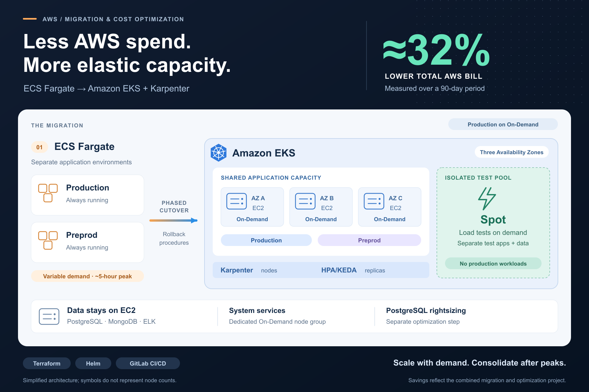

# Amazon EKS Migration & Cost Optimization

A reusable reference for migrating ECS Fargate workloads to Amazon EKS with Karpenter, shared On-Demand application capacity, and isolated Spot testing. Recreated with generic names and configuration; private production code and history are not included.

## The project behind the template

I migrated production and preprod applications from ECS Fargate to Amazon EKS as part of a wider AWS optimization project. The **total AWS bill decreased by approximately 32%, measured over a 90-day period**. This is a self-reported project result, not a benchmark or a savings guarantee for this repository. PostgreSQL rightsizing was a separate part of the optimization; no component-level savings breakdown is available.



[Editable diagram](docs/fargate-eks-migration.svg) · [Case study](docs/case-study.md) · [Architecture](docs/architecture.md) · [Plan coverage](docs/implementation-map.md)

## Included

- Terraform foundation for an EKS cluster in three existing private subnets, dedicated On-Demand system node groups scoped to each AZ, and Karpenter IAM, Pod Identity, and interruption handling resources.
- An offline renderer for Karpenter v1 NodePools and an EC2NodeClass using operator-supplied AMI, role, subnet, and security-group inputs.
- Namespace policies, resource quotas, priorities, runtime service accounts, read-only Role definitions, and optional native admission restrictions.
- Optional KEDA cron/CPU scaling for the confirmed 17:00–22:00 America/New_York peak, with a single autoscaling owner.
- Offline AZ-failure capacity arithmetic and optional initial Prometheus alerts.
- A Helm chart for a synthetic HTTP application (as a practical example), CPU HPA, service, and disruption budget. Production/preprod require On-Demand; testing requires Spot.
- A local billing comparison tool that validates comparable windows and produces an explicitly scoped report.
- GitLab lint/render stages and a manual load-test entry point; GitHub checks for tests, Helm rendering, Terraform validation, and secrets.
- A phased migration runbook with cutover, rollback, capacity, and measurement checkpoints.

## Configuration map

| Component | Configuration |
| --- | --- |
| EKS cluster and add-ons | [terraform/eks.tf](terraform/eks.tf) |
| Karpenter IAM, identity, and interruption queue | [terraform/karpenter.tf](terraform/karpenter.tf) |
| System EC2 node group | [terraform/compute.tf](terraform/compute.tf), instance types/counts in [variables.tf](terraform/variables.tf) |
| Karpenter controller placement and resources | [helm/karpenter/values.yaml](helm/karpenter/values.yaml) |
| Application On-Demand / test Spot instance types, limits, consolidation | [config/capacity.yaml](config/capacity.yaml) |
| Production / preprod / testing replicas and HPA | [environments/](environments/), rendered by [hpa.yaml](helm/workload/templates/hpa.yaml) |
| Namespace isolation, quotas, priorities | [k8s/environments.json](k8s/environments.json) |
| Spot load-test Job | [k8s/load-test-job.yaml](k8s/load-test-job.yaml), [ci/load-test.js](ci/load-test.js) |
| Peak schedule / KEDA | [production values](environments/production.yaml), [ScaledObject](helm/workload/templates/scaledobject.yaml) |
| Admission restrictions | [k8s/admission.yaml](k8s/admission.yaml) |
| Initial monitoring alerts | [k8s/monitoring-alerts.yaml](k8s/monitoring-alerts.yaml) |
| Failure-capacity arithmetic | [scripts/check_capacity.py](scripts/check_capacity.py), [synthetic fixture](samples/capacity.json) |
| Optional AWS budget | [terraform/cost-controls.tf](terraform/cost-controls.tf), `cost_budget` input |
| Manual GitLab load test | [ci/gitlab-ci.yml](ci/gitlab-ci.yml) |

Production and preprod share the application pool. Testing uses its own Spot pool. Terraform owns the system managed node group; Karpenter creates and terminates application/test EC2 instances dynamically. Existing PostgreSQL/MongoDB/ELK instances are retained outside this template. All supplied sizes, limits, and thresholds are illustrative configuration, not private production values.

## Start locally

```sh
python3 -m venv .venv
.venv/bin/python -m pip install -r requirements-dev.txt
make validate PYTHON=.venv/bin/python
```

Validation renders examples and runs tests without cloud credentials. Terraform format checking is included. `make terraform-validate` additionally downloads pinned module/provider dependencies; it does not plan or apply infrastructure.

```sh
python3 scripts/compare_costs.py samples/costs.json
python3 scripts/render_capacity.py --help
python3 scripts/check_capacity.py samples/capacity.json
```

## Repository layout

```text
terraform/            EKS foundation in an existing VPC
helm/workload/        Generic workload, service, HPA, and PDB
helm/karpenter/       Base controller Helm values
environments/        Production, preprod, and testing overrides
config/              Editable application/Spot EC2 capacity settings
k8s/                  Namespace, quota, priority, and network policies
scripts/              Offline capacity renderer and cost comparison
samples/              Synthetic cost inputs, never actual project bills
ci/                   GitLab render checks and manual test-job template
tests/                Cost-tool and rendered-manifest checks
docs/                 Case study, architecture, setup, migration, security
```

## Deployment scope

Follow [setup](docs/setup.md) before using these examples. Infrastructure creation, cluster access, controller installation, manifests, traffic changes, and teardown are operator actions. No script automatically migrates traffic or changes existing ECS services.

The diagram describes the wider completed project. This template implements selected patterns, not a full production platform: scheduled peak scaling is optional and its timing is configured, while measured warm-up lead, reserved AZ-failure capacity, production database access, database rightsizing, application IAM/deployer bindings, and application-specific routing/rollback remain environment work. The [coverage map](docs/implementation-map.md) lists each requirement and its actual implementation status. A three-AZ topology alone does not prove capacity after a zone failure. See [security and limitations](docs/security.md).

## Public content policy

Publish generic code and sanitized architecture only. Exclude client names, account IDs, private endpoints, credentials, state, plans, real cost exports, database copies, and private configuration. The supplied project plan is summarized in English rather than copied into this repository.
